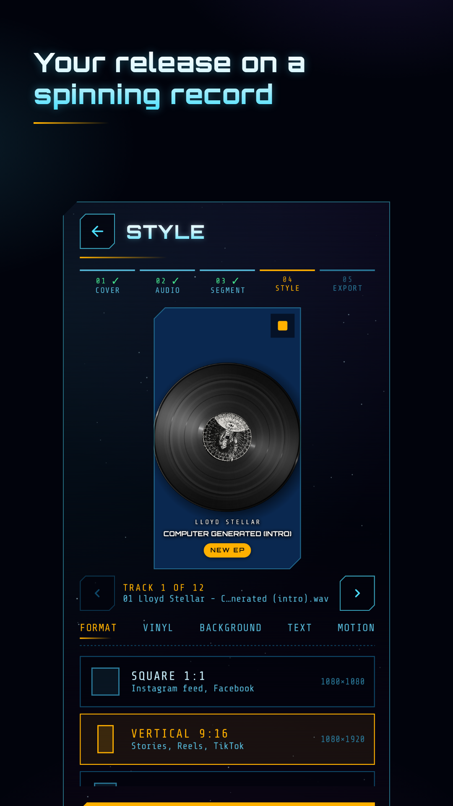
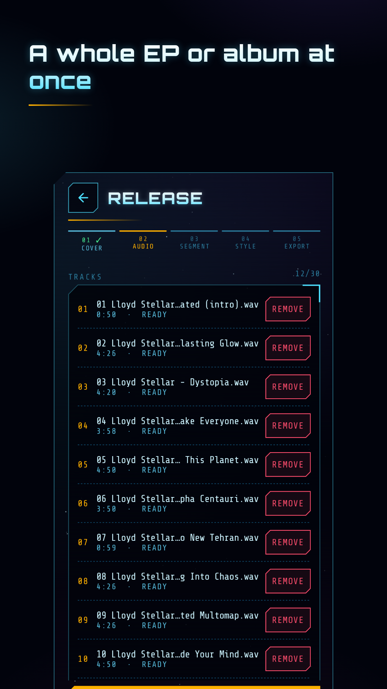
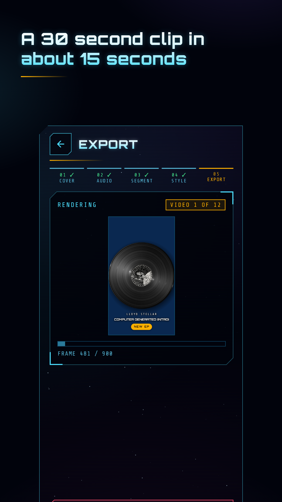
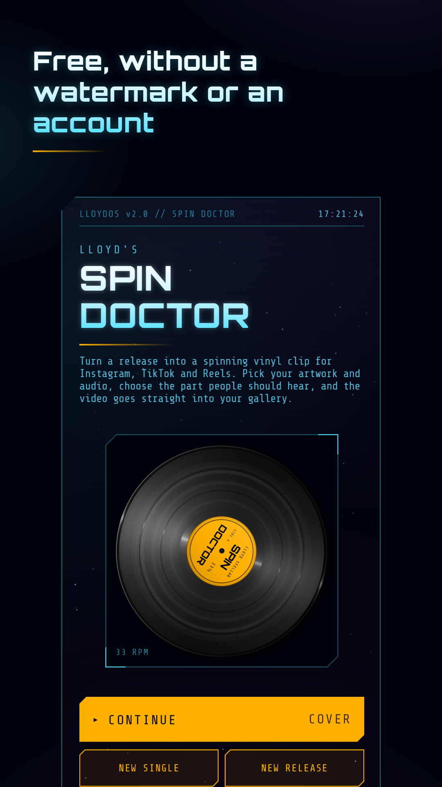

# Spin Doctor for Android

Spin Doctor turns your cover art and a piece of your track into a spinning
vinyl video for Reels, TikTok, Stories and Shorts. The artwork becomes the
label, the record turns while the music plays, and the MP4 lands in your
gallery, ready to share.

It is the Android version of the free web tool on
[lloydstellar.nl/vinyl](https://lloydstellar.nl/vinyl), made by
[Lloyd Stellar](https://lloydstellar.nl), an electro producer from Hilversum.
Everything happens on the phone. The app has no internet permission, no
accounts, no ads and no tracking, and it puts no watermark in your videos.

<p>
  
  
  
  
</p>

## Looking for an iPhone version

There is no iOS version yet, and I would love one. If you build apps for
iPhone and want to port Spin Doctor, open an issue or comment on the
[iOS issue](../../issues?q=label%3Aios). [PORTING.md](PORTING.md) describes
exactly how a frame and its sound are made, with the numbers you need and the
tools to check that your output matches.

## What it does

1. **Cover**: pick the artwork and drag a circle over the part that becomes the label.
2. **Audio**: one track, or a whole release of up to 30 tracks.
3. **Clip**: choose 5 to 60 seconds of each track on the waveform.
4. **Style**: black, coloured, splatter or marble vinyl, speed, size, background colour or blurred photo, artist and title in three type styles, a badge (OUT NOW, NEW EP, a release date or your own text), beat pulse, spin up with the music speeding up along with the record, and square, 9:16 or 4:5.
5. **Export**: one video per track, 1080 px wide at 30 fps, H.264 and AAC. A 30 second clip takes 12 to 15 seconds on a Pixel 8.

## Build

You need JDK 21 and the Android SDK (compile SDK 37). Android Studio has both.

```
./gradlew :app:testDebugUnitTest          # unit tests: PRNG, titles, badges, beat envelope, spin up
./gradlew :app:assembleDebug              # debug build (package nl.lloydstellar.spindoctor.debug)
adb install -r app/build/outputs/apk/debug/app-debug.apk
```

The app runs on Android 12 and up (`minSdk 31`).

Release builds are signed with a key in `signing/`, which is not in this
repository. Without it `assembleRelease` still builds, unsigned.

### On-device tests

These run against the `perf` build type (release speed, debug signing):

```
./gradlew -PtestBuildType=perf :app:installPerf :app:installPerfAndroidTest
adb shell am instrument -w -e class nl.lloydstellar.spindoctor.ExportPipelineTest -e format VERTICAL \
    nl.lloydstellar.spindoctor.perf.test/androidx.test.runner.AndroidJUnitRunner
adb pull /sdcard/Android/data/nl.lloydstellar.spindoctor.perf/files/export-test-vertical-mp3.mp4
python3 tools/check_export.py export-test-vertical-mp3.mp4 --start 10
```

`ExportPipelineTest` exports a clip of a 120 BPM kick track and
`check_export.py` checks the result: every kick in its place, no gaps in the
sound, the beat pulse on the kick. `DecodeSpeedTest` times the decoders.

`RenderParityTest` renders the scenes in `tools/parity/scenes.json` to
`Android/data/<app>/files/parity`. `tools/parity/render-web.sh app.js out/`
renders the same scenes with the website's code in headless Chromium, so you
can compare them side by side. The app and the site differ by 0.5 to 1.6%
RMSE, mostly font rendering and anti-aliasing.

## What is where

| Path | What |
|---|---|
| `app/src/main/java/.../render/` | The frame renderer, a port of `renderVinylFrame()` in the website's `app.js`: the disc and its light (`DiscArt`), splatter and marble (`Patterns`, seeded exactly like the site), text and badge (`Overlay`), blurred background (`Backdrop`). The preview and the export both call `VinylRenderer.render`. |
| `app/src/main/java/.../audio/` | `AudioDecoder` (waveform and segments, MP3/WAV/FLAC/M4A/OGG), `BeatEnvelope` (the beat pulse), `ClipAudio` (the sound of the spin up), `ClipPlayer` and `PcmPlayer` (playback while choosing and styling). |
| `app/src/main/java/.../export/` | `Mp4Encoder` (hardware H.264 and AAC into MP4), `GlBridge` (GPU path from canvas to encoder), `Exporter` (one clip after the other), `ExportService` (keeps a long release going in the background), `Gallery` (saves to Movies/Spin Doctor), `Share`. |
| `app/src/main/java/.../model/` | `Look` (every style option with its range and default), `Session`, `SpinUp`, `Prefs`. |
| `app/src/main/java/.../ui/` | Jetpack Compose screens in the LLOYDOS look of the website. |
| `app/src/main/assets/fonts/` | Orbitron and Share Tech Mono, under the SIL Open Font License. |
| `tools/parity/` | Website reference renders and the beat envelope reference for the unit test. |
| `tools/store/` | Play Store texts, icon, feature graphic and screenshots. |
| `tools/make_icon.py`, `tools/make_store_graphics.py` | Draw the icon and build the store graphics. |

## How a video is made

1. The segment is decoded with the platform codecs. MP3 frames go many to a buffer, other formats use the large frame mode of Android 15, because every codec buffer costs about a millisecond. An 8 minute track is read in a few seconds.
2. Every frame is drawn by the same renderer as the preview, on the GPU: a hardware canvas into a `SurfaceTexture`, then OpenGL ES into the encoder's input surface with the exact frame time (`eglPresentationTimeANDROID`). No frame goes through main memory and none can be dropped.
3. The sound is encoded to AAC. The encoder's 2048 samples of start-up are left out, so sound and picture start together.
4. The MP4 is copied to Movies/Spin Doctor.

## Differences from the website

- Videos are 1080 px wide in every format: 1080x1080, 1080x1920 and 1080x1350. The site encodes 1080 high (608x1080 for 9:16). Everything in a frame scales with its size, so the picture is the same, only sharper.
- Wider limits: up to 30 tracks of up to an hour, clips of 5 to 60 seconds, artwork of any size (scaled down to 2048 px when read).
- Spin up plays the music along with the record: silent at standstill, then rising from a low rumble to normal pitch, with the level following the speed. The length is adjustable from 0.3 to 6 seconds. The curve is speed = 1 - (1 - t/T)², which lands exactly on full speed at T. The website's exponential curve never quite gets there, which would leave the music audibly flat after a long spin up.
- The whole style is remembered between sessions, except the release date.
- A file name like `03 Lloyd Stellar - Dystopia.wav` gives the title Dystopia and, if the artist field is empty, the artist Lloyd Stellar.
- The clean text style uses the phone's sans serif, because Android has no Helvetica Neue.
- MP3 and M4A are decoded by Android, which places the start of a track a few dozen milliseconds differently from Chrome. Sound and pulse stay together; a segment can start that much earlier in the music than on the site.

## Contributing

Bug reports and pull requests are welcome. Keep the preview and the export on
the same renderer, and run the unit tests before you send a change to
`render/` or `audio/`. If you change how a frame looks, say so in the pull
request with a before and after.

## License

The code is licensed under the [Apache License 2.0](LICENSE). The fonts keep
their own license (SIL Open Font License, in `app/src/main/assets/licenses/`).

The license covers the code, not the name or the artwork. "Spin Doctor", the
app icon, the Lloyd Stellar name and the artwork in the screenshots are not
part of it. If you publish your own build, give it another name and icon and a
different package name. See [NOTICE](NOTICE).
